<div align="center">
  <h1>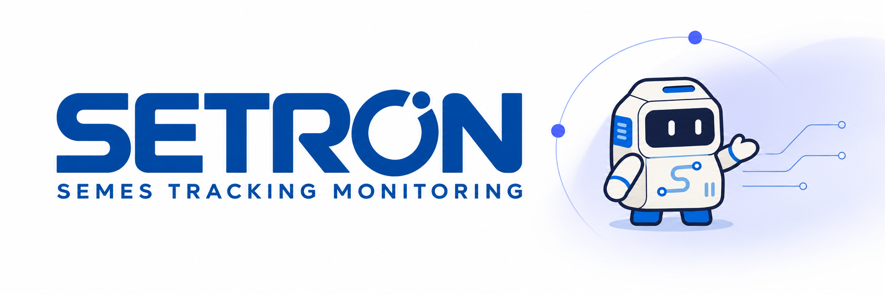</h1>
  <h3>반도체 설비 소프트웨어 버전 관리 도구</h3>
  <p>흩어져 있던 설비 현황표와 릴리스 노트를 한곳에서 관리하고,<br />
    생산 라인별 설치 버전을 비교해 업데이트가 필요한 설비를 한눈에 보여 줍니다.</p>
  <p>
    <strong>팀</strong> SSAFY 대전 B106 · 마블룰렛 · SEMES 연계 프로젝트<br />
    <strong>개발 인원</strong> 6명<br />
    <strong>개발 기간</strong> 2026.10.07 ~ 2026.11.18<br />
    <strong>플랫폼</strong> Windows 데스크톱
  </p>
  <p>
    <a href="https://github.com/setron-B106/Setron/releases/tag/ver1.0.0"><strong>Windows 배포본</strong></a> ·
    <a href="https://github.com/setron-B106/Setron/releases/download/ver1.0.0/SETRON-1.0.0-presentation.pdf">발표 자료 (PDF)</a> ·
    <a href="https://github.com/setron-B106/Setron/releases/download/ver1.0.0/SETRON-1.0.0-presentation.mp4">서비스 소개 영상</a>
  </p>
</div>

---

## 📑 목차

- [서비스 소개](#service-introduction)
- [팀원 소개](#team)
- [주요 기능](#features)
- [기술 스택](#technology-stack)
- [시스템 아키텍처](#system-architecture)
- [ERD](#erd)
- [핵심 기술](#technology-details)
- [API 명세](#api-and-erd)
- [개발자 가이드](#getting-started)
- [디렉터리 구조](#directory-structure)
- [프로젝트 문서와 협업 규칙](#project-guide)

---

<a id="service-introduction"></a>

## 💡 서비스 소개

설비 현황표에는 점검일에 어떤 소프트웨어가 설치돼 있었는지가 기록됩니다. 릴리스 노트에는 버전마다 추가된 기능과 수정된 결함이 담깁니다. SETRON은 두 자료를 연결해 **어느 설비에 어떤 업데이트가 필요한지** 찾을 수 있게 합니다.

| 현장에서 궁금한 점 | 살펴볼 화면 |
| --- | --- |
| 이번 점검은 어느 라인부터 시작할까? | **대시보드**에서 라인별 목표 달성률을 비교하고, **버전 히트맵**에서 점검할 설비의 설치 이력을 봅니다. |
| 특정 결함을 수정한 버전이 어디에 적용됐을까? | **아이템 매니저**에서 기능명이나 Jira 코드로 변경 항목을 찾아 적용 설비와 미적용 설비를 확인합니다. |
| 지난 점검 이후 무엇이 달라졌을까? | **버전 리플레이**에서 날짜별 달성률과 분포를 비교하고, **보고서**에서 공유할 표와 그래프를 고릅니다. |

---

<a id="team"></a>

## 👥 팀원 소개

<div align="center">
<table align="center">
  <tr>
    <td align="center" width="185"><br /><strong>박호진</strong><br />팀장 · AI 및 데이터<br /><a href="https://github.com/hohojinjin">&nbsp;hohojinjin</a></td>
    <td align="center" width="185"><br /><strong>김보경</strong><br />프론트엔드<br /><a href="https://github.com/BooGyya">&nbsp;BooGyya</a></td>
    <td align="center" width="185"><br /><strong>임세희</strong><br />프론트엔드<br /><a href="https://github.com/1lights1">&nbsp;1lights1</a></td>
  </tr>
  <tr>
    <td align="center" width="185"><br /><strong>황민정</strong><br />프론트엔드<br /><a href="https://github.com/alswjd131313">&nbsp;alswjd131313</a></td>
    <td align="center" width="185"><br /><strong>김진광</strong><br />백엔드<br /><a href="https://github.com/Kim-jin-gwang">&nbsp;Kim-jin-gwang</a></td>
    <td align="center" width="185"><br /><strong>김지훈</strong><br />백엔드<br /><a href="https://github.com/2hnK">&nbsp;2hnK</a></td>
  </tr>
</table>
</div>

---

<a id="features"></a>

## ✨ 주요 기능

<table width="100%">
  <thead>
    <tr><th width="56%">화면</th><th width="44%">설명</th></tr>
  </thead>
  <tbody>
    <tr>
      <td width="56%"><a href="docs/media/demos/07-import.gif">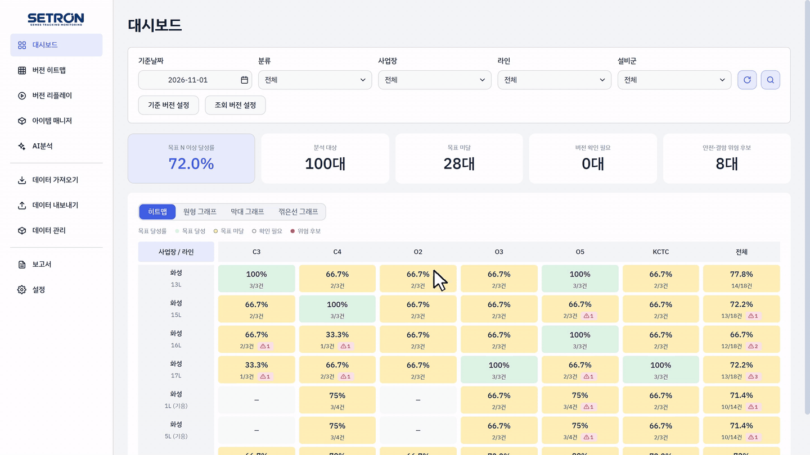</a></td>
      <td width="44%" valign="middle"><strong>Excel 현황표 가져오기</strong><br /><br />열려 있는 Excel 통합문서에서 시트를 고른 뒤 추출한 값을 원본 셀과 대조합니다. 시연에서는 평택 설비 24대에 기준일과 사업장을 한 번에 입력해 저장합니다.</td>
    </tr>
    <tr>
      <td width="56%"><a href="docs/media/screens/import-find-replace.png">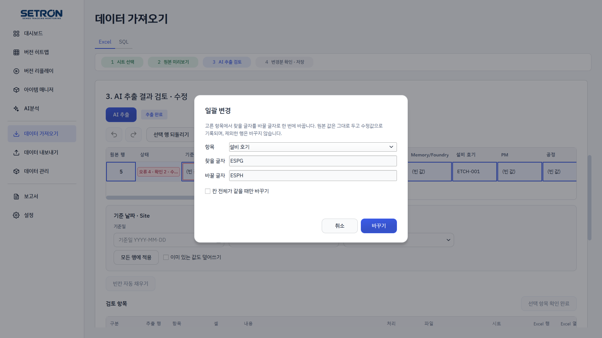</a></td>
      <td width="44%" valign="middle"><strong>추출한 값 찾아 바꾸기</strong><br /><br />설비 호기처럼 같은 표기가 반복된 열은 한 번에 고칠 수 있습니다. 그림은 ESPG를 ESPH로 바꾸기 전의 설정 화면입니다. 원본 셀 값은 보존하고, 검토에서 제외한 행은 건너뜁니다.</td>
    </tr>
    <tr>
      <td colspan="2">
        <p align="center"><strong>평택 설비 24대 추가 전후</strong><br />2026년 11월 1일 기준</p>
        <table width="100%">
          <tr>
            <td width="50%" align="center" valign="top">
              <strong>가져오기 전 · 화성</strong><br />
              <a href="docs/media/screens/dashboard-before-import.png">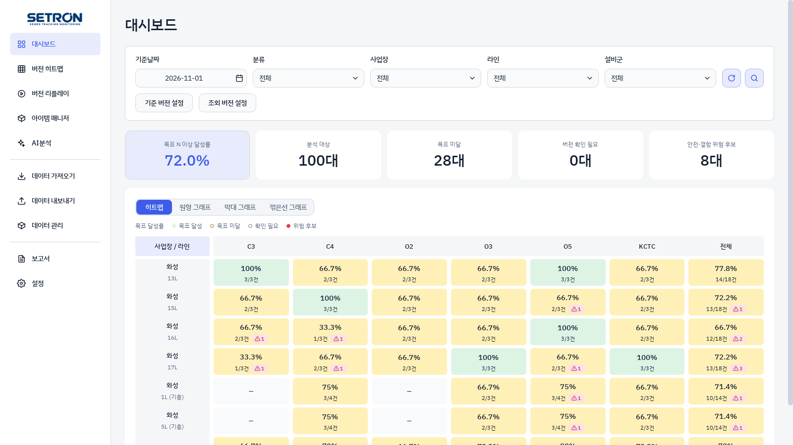</a><br />
              설비 <strong>100대</strong> · 목표 달성률 <strong>72.0%</strong> · 위험 후보 <strong>8대</strong>
            </td>
            <td width="50%" align="center" valign="top">
              <strong>가져온 뒤 · 화성·평택</strong><br />
              <a href="docs/media/screens/dashboard-after-import.png">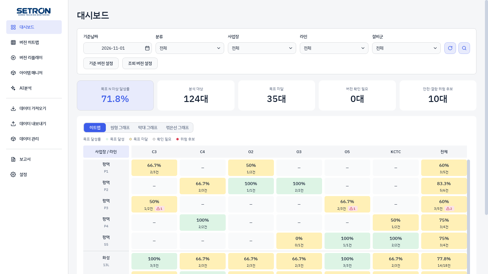</a><br />
              설비 <strong>124대</strong> · 목표 달성률 <strong>71.8%</strong> · 위험 후보 <strong>10대</strong>
            </td>
          </tr>
        </table>
      </td>
    </tr>
    <tr>
      <td width="56%"><a href="docs/media/demos/02-target-version.gif">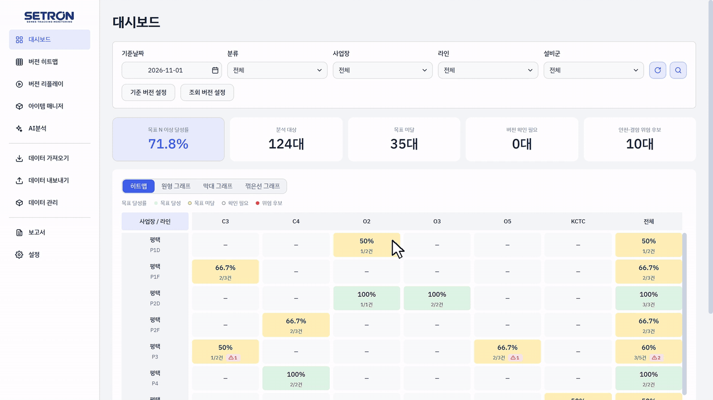</a></td>
      <td width="44%" valign="middle"><strong>목표 버전 설정</strong><br /><br />모델과 소프트웨어 계열별로 목표 버전(N)을 정하면 대시보드와 히트맵에 같은 기준이 적용됩니다. 저장 이력에서 이전에 어떤 버전을 기준으로 삼았는지도 확인할 수 있습니다.</td>
    </tr>
    <tr>
      <td width="56%"><a href="docs/media/demos/01-dashboard.gif"></a></td>
      <td width="44%" valign="middle"><strong>라인별 목표 달성률</strong><br /><br />사업장과 라인을 골라 목표에 미달한 설비가 어디에 모여 있는지 봅니다. 막대그래프는 라인별 비교에, 꺾은선그래프는 날짜별 추이를 살필 때 씁니다.</td>
    </tr>
    <tr>
      <td width="56%"><a href="docs/media/demos/03-version-heatmap.gif">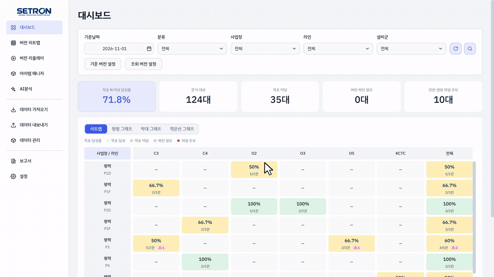</a></td>
      <td width="44%" valign="middle"><strong>설비별 버전 히트맵</strong><br /><br />라인이나 설비군별로 묶어 보거나 위험 후보만 골라 봅니다. 설비를 선택하면 설치 버전과 이전 점검 기록을 확인할 수 있습니다.</td>
    </tr>
    <tr>
      <td width="56%"><a href="docs/media/demos/05-item-manager.gif">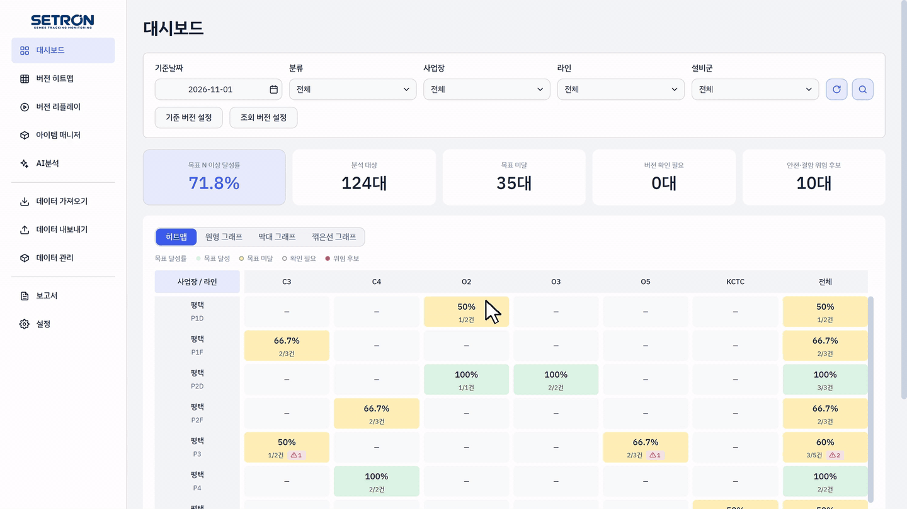</a></td>
      <td width="44%" valign="middle"><strong>변경 항목별 적용 현황</strong><br /><br />기능명이나 Jira 코드로 변경 항목을 검색합니다. 항목을 펼치면 어느 설비에 반영됐고 어느 설비에 아직 적용되지 않았는지 알 수 있습니다.</td>
    </tr>
    <tr>
      <td width="56%"><a href="docs/media/screens/item-risk-preview.png">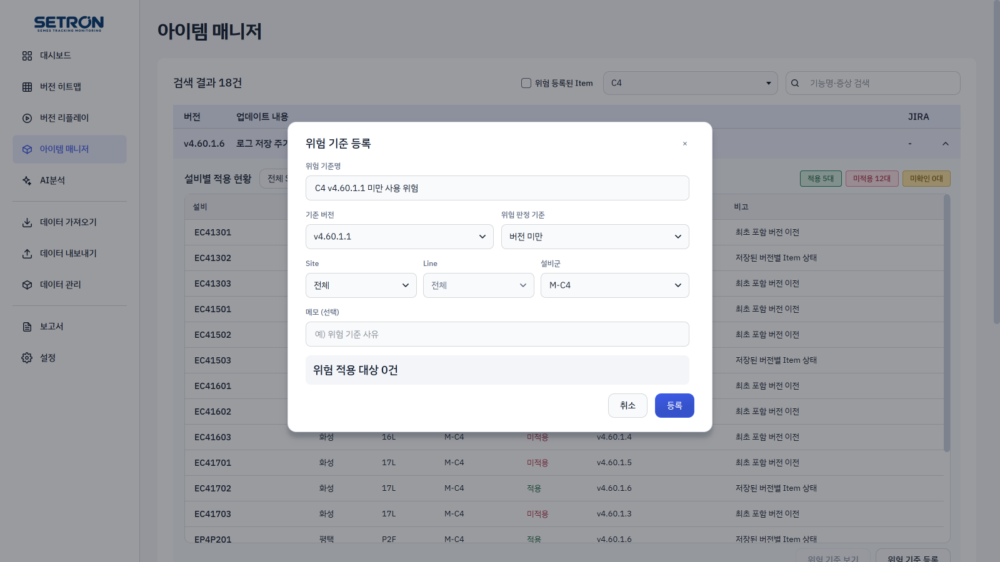</a></td>
      <td width="44%" valign="middle"><strong>위험 기준 등록 전 영향 확인</strong><br /><br />등록할 기준 버전과 적용 범위를 정하면 영향받는 설비가 몇 대인지 먼저 확인할 수 있습니다. 시연 화면의 기준은 M-C4 모델의 v4.60.1.1 미만이며, 화면의 적용 대상은 0건입니다.</td>
    </tr>
    <tr>
      <td width="56%"><a href="docs/media/demos/04-version-replay.gif"></a></td>
      <td width="44%" valign="middle"><strong>버전 리플레이</strong><br /><br />화성의 여섯 차례 점검 기록을 날짜순으로 재생합니다. 달성률이 바뀐 날에 멈춰 히트맵을 열면 어느 라인과 설비군에서 변화가 있었는지 볼 수 있습니다.</td>
    </tr>
    <tr>
      <td width="56%"><a href="docs/media/demos/06-ai-analysis.gif"></a></td>
      <td width="44%" valign="middle"><strong>AI로 업데이트 우선순위 조회</strong><br /><br />업데이트가 시급한 설비와 추천 이유를 표로 봅니다. 시연의 예제 응답은 우선순위 상위 두 대를 목표 버전으로 올릴 경우 달성률이 71.8%에서 73.4%로 바뀐다고 보여 줍니다.</td>
    </tr>
    <tr>
      <td width="56%"><a href="docs/media/demos/10-reports.gif">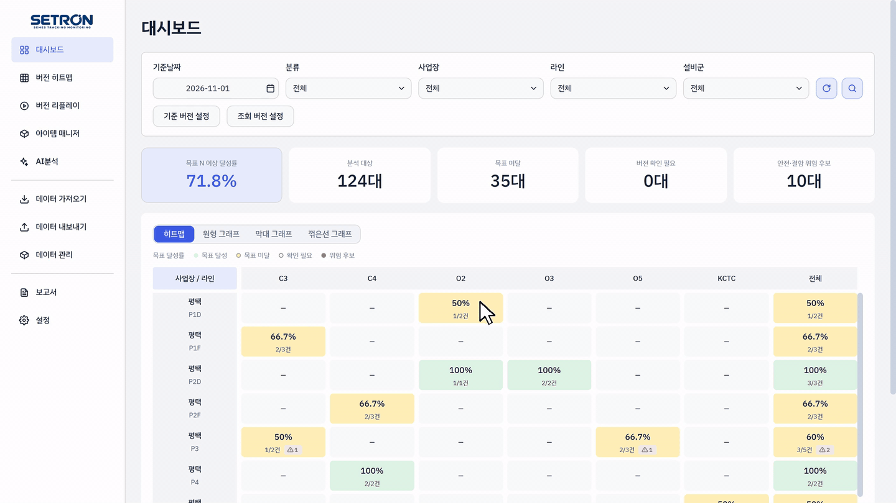</a></td>
      <td width="44%" valign="middle"><strong>보고서 만들기</strong><br /><br />조회 기간을 정하고 달성률 추이, 히트맵, 위험 판정 근거 중 필요한 항목을 고릅니다. 완성한 보고서를 미리 보고 Word나 PDF로 저장합니다.</td>
    </tr>
    <tr>
      <td width="56%"><a href="docs/media/screens/report-export-formats.png">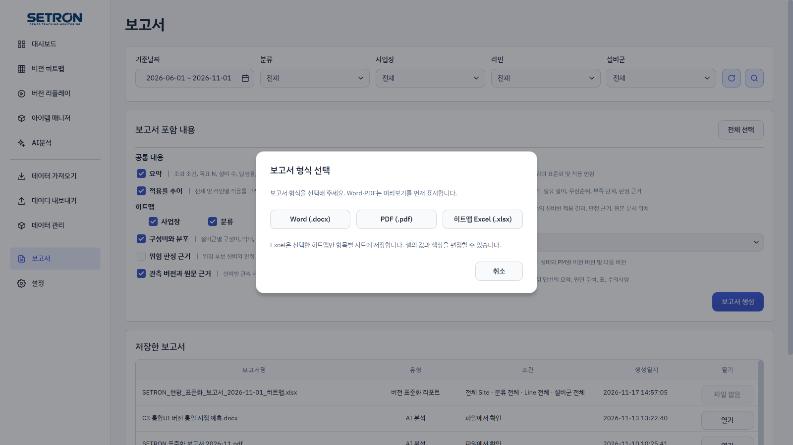</a></td>
      <td width="44%" valign="middle"><strong>편집 가능한 히트맵 Excel</strong><br /><br />보고서에서 필요한 히트맵을 고르고 Excel 형식으로 저장하면 항목마다 시트가 하나씩 생깁니다. Excel에서 셀 값과 색을 직접 편집할 수 있습니다.</td>
    </tr>
    <tr>
      <td width="56%"><a href="docs/media/demos/09-data-management.gif"></a></td>
      <td width="44%" valign="middle"><strong>설비 기록 관리</strong><br /><br />위치 탭에서 사업장과 라인을 선택해 소속 설비를 확인합니다. 가져온 Excel 자료는 삭제 전 영향을 검토할 수 있고, 변경 이력에서는 기존 값과 수정한 값을 비교할 수 있습니다.</td>
    </tr>
    <tr>
      <td width="56%"><a href="docs/media/demos/08-export.gif"></a></td>
      <td width="44%" valign="middle"><strong>Excel 내보내기와 SQL 백업</strong><br /><br />조회 결과는 Excel로 내보내고 전체 데이터는 SQL로 백업합니다. 다른 PC에서 백업을 가져올 때는 <a href="docs/media/screens/sql-import-options.png">자동 병합·충돌 검토</a> 방식을 선택할 수 있습니다.</td>
    </tr>
    <tr>
      <td width="56%"><a href="docs/media/demos/11-settings.gif"></a></td>
      <td width="44%" valign="middle"><strong>글자 크기와 색각 보정</strong><br /><br />글자 크기와 포인트 색을 고르고 대시보드와 히트맵에 색각 보정 팔레트를 적용할 수 있습니다. 목표 달성·미달을 나타내는 색과 위험 후보의 테두리색도 직접 지정할 수 있습니다.</td>
    </tr>
    <tr>
      <td width="56%"><a href="docs/media/demos/12-dark-mode.gif">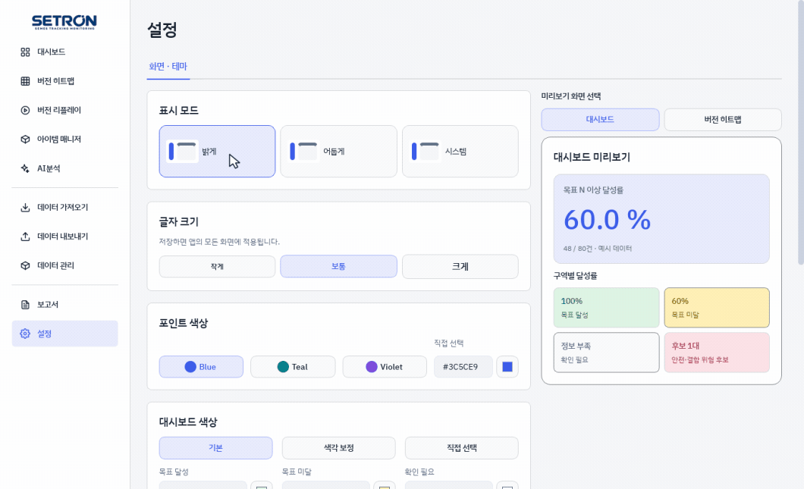</a></td>
      <td width="44%" valign="middle"><strong>다크 모드 전환</strong><br /><br />표시 모드에서 ‘어둡게’를 선택하고 저장하면 앱 전체에 다크 모드가 적용됩니다. ‘시스템’을 선택하면 Windows 테마를 따릅니다. 이 장면은 예제 데이터로 추가 촬영했습니다.</td>
    </tr>
  </tbody>
</table>

---

<a id="technology-stack"></a>

## 🛠️ 기술 스택

| 쓰임 | 기술 |
| --- | --- |
| Windows 앱과 화면 |   |
| 설비 이력 저장·조회 |    |
| Excel 자료 가져오기·내보내기 |    |
| Word·PDF 보고서 생성 |   |
| Excel 값 추출·자연어 질문 해석 |  |
| 개발 환경·테스트·Windows 배포 |     |

---

<a id="system-architecture"></a>

## 🏗️ 시스템 아키텍처

### 서비스 구성

[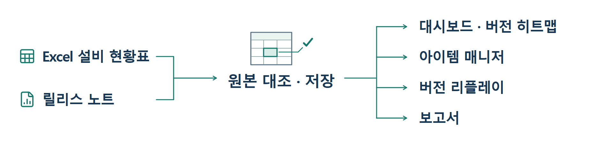](docs/media/design/service-architecture.png)

설비 현황표에는 **설비별 설치 버전**이, 릴리스 노트에는 **버전별 변경 사항**이 담겨 있습니다. 담당자는 Excel에서 두 자료를 가져와 추출값을 원본과 대조하고, 잘못 읽힌 값을 고친 뒤 변경분을 저장합니다.

- **대시보드와 버전 히트맵**에서 목표에 미달한 설비와 위험 후보를 찾고, 설비를 선택해 설치 이력을 확인합니다.
- **아이템 매니저**에서는 특정 변경 사항이 어느 설비에 적용됐는지 확인합니다. **버전 리플레이**에서는 날짜에 따라 목표 달성률과 버전 분포가 어떻게 달라졌는지 비교합니다.
- **보고서**에서는 공유할 표와 그래프를 골라 Word 또는 PDF로 저장합니다.

### 인프라 구성

[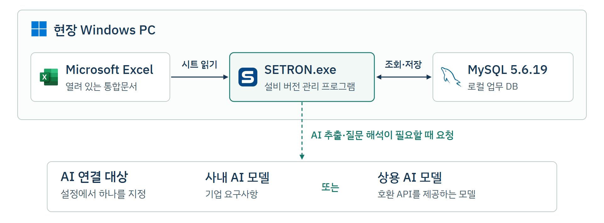](docs/media/design/infrastructure.png)

현장 PC에서 `SETRON.exe`는 열려 있는 Excel 시트를 읽고, 담당자가 확인한 값을 같은 PC의 MySQL 5.6.19에 저장합니다. 대시보드와 보고서는 이렇게 쌓인 기록을 사용합니다.

기업 요구사항에 맞춘 구성에서는 Excel 값 추출과 자연어 질문 해석에 **사내 AI 모델**을 사용합니다. 같은 Chat Completions API 형식을 지원하는 **상용 AI 모델**도 연결할 수 있습니다. 배포 시 `setron.env`에 사용할 서버 주소, 모델명, 인증 키를 지정합니다. [AI 연결 설정](exec/외부서비스.md)

---

<a id="erd"></a>
<a id="공통-스키마"></a>

## 🗄️ ERD

[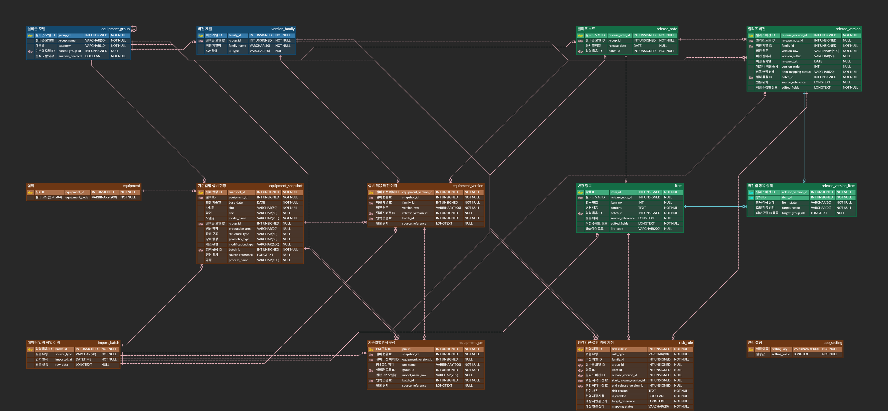](docs/media/design/SETRON-ERD.png)

---

<a id="technology-details"></a>

## 🔬 핵심 기술

### 1. Excel 원본 셀과 추출값 대조

[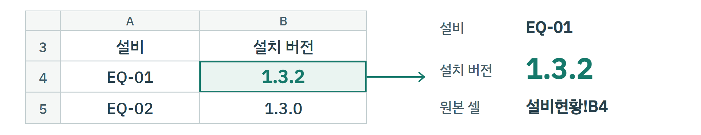](docs/media/design/core-excel-review.png)

예시에서 설비 `EQ-01`의 설치 버전 `1.3.2`는 `설비현황` 시트의 `B4` 셀에서 읽은 값입니다. 검토 표에는 값과 원본 위치가 함께 남아, 잘못 읽힌 값이 있으면 담당자가 해당 셀과 대조해 저장 전에 바로잡을 수 있습니다. 정해진 양식은 규칙으로 읽고, 다른 양식에는 AI 추출을 사용할 수 있습니다.

### 2. 목표 달성률과 위험 후보 판정

[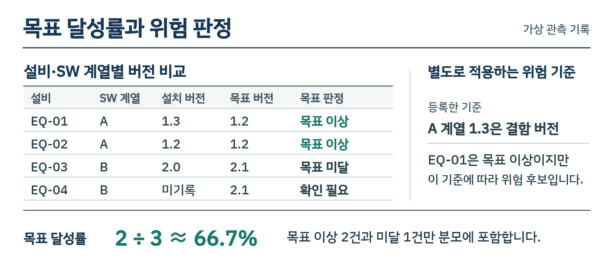](docs/media/design/core-target-risk.png)

목표 달성률은 설비에 설치된 소프트웨어 계열마다 목표 버전과 설치 버전을 비교해 계산합니다. 예시의 네 건 중 `EQ-04`는 설치 버전이 없어 계산에서 빠집니다. 판정 가능한 세 건 중 두 건이 목표 이상이므로 **달성률은 66.7%**입니다.

위험 후보는 등록한 위험 기준에 따라 설비 대수로 집계합니다. 예를 들어 `EQ-01`은 목표 버전 1.2를 넘겼지만, 설치한 버전 1.3이 A 계열의 결함 버전으로 등록돼 있어 **위험 후보**에 포함됩니다. [대시보드 지표 정의](docs/dashboard.md)

### 3. 자연어 질문으로 설비 조회

[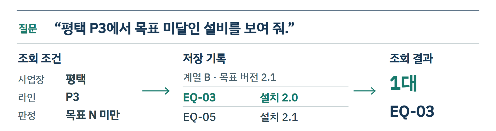](docs/media/design/core-query-analysis.png)

“평택 P3에서 목표 미달인 설비를 보여 줘”라고 물으면 AI가 질문을 **평택 사업장 · P3 라인 · 목표 버전 미달**이라는 조회 조건으로 바꿉니다. 앱은 이 조건을 검증하고 저장된 설치 기록과 대조합니다.

예시에서 B 계열의 목표 버전은 2.1입니다. 버전 2.0인 `EQ-03`만 미달 목록에 포함되고, 버전 2.1인 `EQ-05`는 목표를 달성했습니다. 답변 아래 **판단 근거**를 열면 조회에 쓰인 조건을 확인할 수 있습니다. [질문 해석과 집계 방식](docs/ai-analysis-plan-first.md)

---

<a id="api-and-erd"></a>

## 📋 API 명세

Excel 값 추출과 질문 해석에는 설정한 모델 서버의 HTTP API를 사용합니다. Excel 시트 읽기와 설비 기록 저장은 Windows 앱이 직접 처리합니다.

| 기능 | 연결 방식 | 구현 · 설정 |
| --- | --- | --- |
| AI 추출과 질문 해석 | Chat Completions API · `POST {SETRON_AI_BASE_URL}/chat/completions` | [API 설정](exec/외부서비스.md) · [AI 클라이언트](src/setron/infrastructure/ai_client.py) |
| Excel 시트 읽기 | xlwings로 실행 중인 Excel에 연결해 통합문서, 시트, 셀 값을 읽습니다. | [Excel 읽기 모듈](src/setron/infrastructure/excel_reader.py) |
| 설비 기록 저장과 조회 | SQLAlchemy와 PyMySQL로 MySQL에 연결합니다. | [DB 연결 모듈](src/setron/infrastructure/database.py) · [DB 스키마](database/schema_mysql5619.sql) |

---

<a id="getting-started"></a>

## 🚀 개발자 가이드

<details>
<summary><strong>Windows 배포본 실행하기</strong></summary>

1. Windows 10 이상 64비트 PC에서 [배포 ZIP](https://github.com/setron-B106/Setron/releases/download/ver1.0.0/SETRON-1.0.0-windows-x64.zip)을 내려받아 압축을 모두 풉니다.
2. `SETRON.exe`를 열면 예시 데이터로 대시보드와 히트맵을 둘러볼 수 있습니다.
3. 실제 설비 기록을 저장하려면 [Windows 실행 안내](docs/windows-package.md)에 따라 로컬 MySQL을 연결합니다.

</details>

<details>
<summary><strong>소스에서 실행하고 테스트하기</strong></summary>

### 소스 설치와 첫 실행

Windows PC에 Git, Python 3.13, uv를 설치한 뒤 PowerShell에서 실행합니다.

```powershell
git clone https://github.com/setron-B106/Setron.git
cd Setron
uv sync --locked
uv run --locked python -m setron
```

실제 현황표를 가져오려면 Windows용 데스크톱 Excel에서 통합문서를 먼저 엽니다.

<a id="db-연동-개발-기준"></a>
<a id="docker로-개발테스트-db-실행"></a>
<a id="db-연결과-저장-처리-be-001"></a>

### 개발용 MySQL 연결

1. 처음 설정할 때 `.env.example`을 `.env`로 복사하고 개발·테스트 DB 비밀번호를 입력합니다.
2. Docker Desktop의 Linux 엔진을 시작하고 개발 DB를 실행합니다.

   ```powershell
   docker compose build mysql-dev
   docker compose up -d --wait mysql-dev
   ```

3. 새 DB에는 포팅 매뉴얼 2-4절에 따라 테이블을 한 번 생성합니다. 아래 명령으로 연결을 확인하고 앱을 실행합니다. [포팅 매뉴얼](exec/포팅매뉴얼.md)

   ```powershell
   uv run --locked --env-file .env python -m setron.infrastructure.database
   uv run --locked --env-file .env python -m setron
   ```

### 테스트

```powershell
uv run --locked python -m pytest tests/test_ui_common.py -q
```

위 명령은 공통 화면 테스트를 실행합니다. MySQL 통합 테스트는 전용 테스트 DB에서 실행합니다. [전체 테스트 가이드](docs/testing.md)

</details>

---

<a id="directory-structure"></a>

## 📁 디렉터리 구조

<details>
<summary><strong>주요 디렉터리 보기</strong></summary>

```text
Setron/
├── src/setron/
│   ├── __main__.py       # 앱 실행 진입점
│   ├── ui/               # 대시보드·히트맵·리플레이 등 업무 화면
│   ├── features/         # 가져오기·버전 비교·위험 판정·보고서
│   └── infrastructure/   # Excel·MySQL·AI 연결
├── database/             # 스키마와 시연 DB 준비 도구
├── docker/               # 개발·테스트용 MySQL 이미지
├── packaging/            # Windows 실행 파일 빌드
├── tests/                # 업무 로직·화면·DB 테스트
├── ai/                   # 데이터 추출 실험과 검증 자료
├── docs/                 # 화면 설계·협업 규칙·검증 기록
├── exec/                 # 포팅 매뉴얼·시연 시나리오·DB 덤프
├── compose.yaml          # 개발·테스트 DB 서비스
├── pyproject.toml        # Python 및 패키지 설정
└── uv.lock               # 의존성 버전 고정
```

</details>

---

<a id="project-guide"></a>

## 📚 프로젝트 문서와 협업 규칙

<details>
<summary><strong>문서와 협업 규칙 보기</strong></summary>

| 문서 | 담고 있는 내용 |
| --- | --- |
| [발표 자료](https://github.com/setron-B106/Setron/releases/download/ver1.0.0/SETRON-1.0.0-presentation.pdf) · [서비스 소개 영상](https://github.com/setron-B106/Setron/releases/download/ver1.0.0/SETRON-1.0.0-presentation.mp4) | 프로젝트 배경을 소개하는 발표 자료와 주요 사용 흐름을 보여 주는 1분 37초 영상 |
| [시연 시나리오](exec/시연시나리오.md) | 현황표를 읽고 업데이트 대상을 찾아 보고서로 공유하는 시연 순서 |
| [대시보드](docs/dashboard.md) · [아이템 매니저](docs/item-manager-ver5.md) · [버전 리플레이](docs/replay-ver5.md) | 목표 달성률·위험 후보의 판정 기준, 변경 항목의 적용 여부, 날짜별 조회 방식 |
| [포팅 매뉴얼](exec/포팅매뉴얼.md) · [외부 서비스](exec/외부서비스.md) | DB 초기 설정, AI API 연결, Windows 배포 |
| [시스템 구성](docs/architecture.md) · [테스트 가이드](docs/testing.md) | 코드의 모듈별 책임과 기능별 검증 절차 |
| [GitLab 인계 문서](https://github.com/setron-B106/Setron/blob/817670a79b05d58e25c451cdf86d06c1398f742e/README.md) | GitLab 완성본의 DB 설정, 저장 동작과 화면별 구현 내역 |

Gitflow에 따라 기능 브랜치를 `develop`에 병합합니다. 릴리스는 `release/*` 브랜치에서 검증한 뒤 `master`에 병합하고 버전 태그를 붙입니다. 배포한 변경은 `develop`에도 반영합니다. [Git 협업 규칙](docs/git-conventions.md)

</details>
