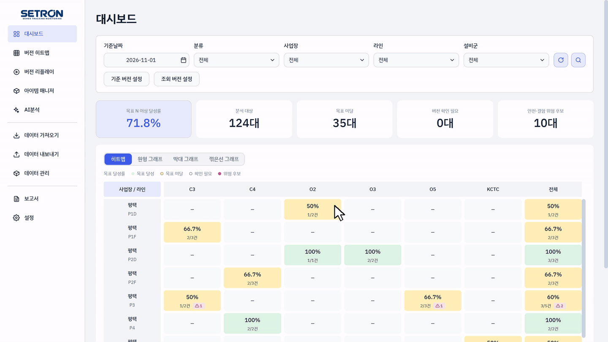
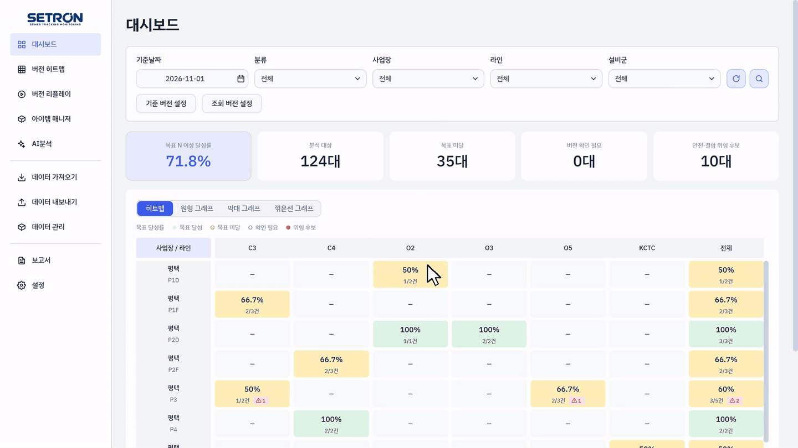
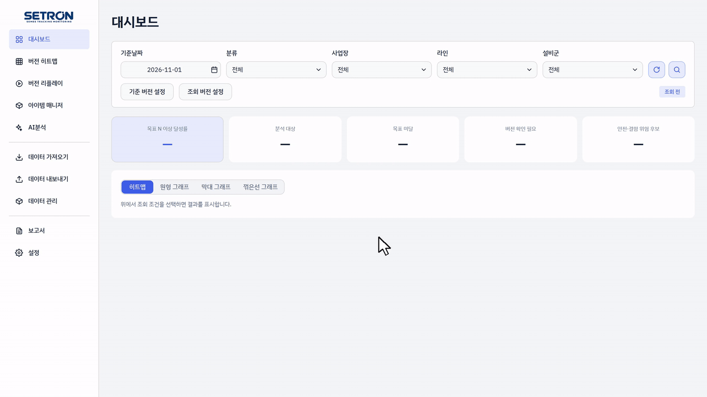
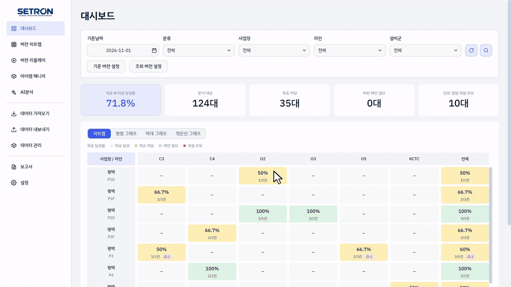
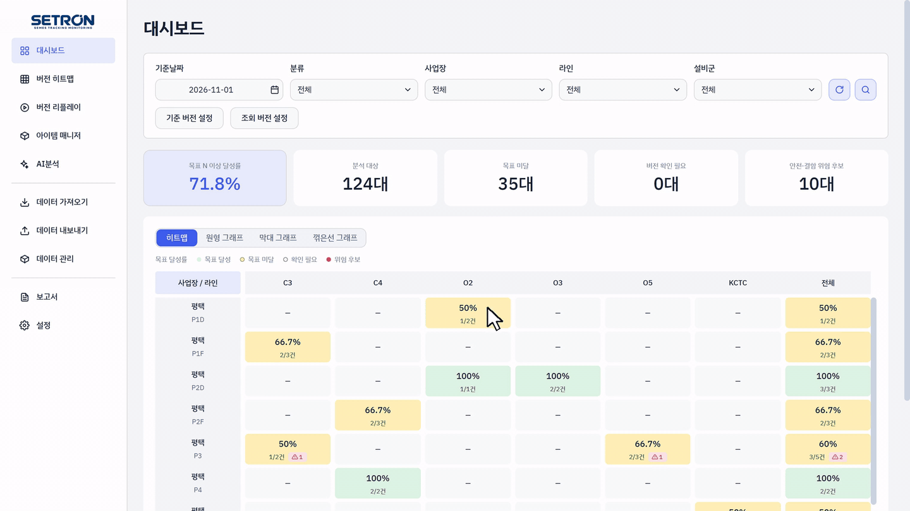

<div align="center">
  <h1></h1>
  <h3>반도체 설비 소프트웨어 버전 관리 도구</h3>
  <p>설비 현황표와 릴리스 노트를 한곳에 모아, 생산라인별 소프트웨어 버전과 업데이트가 필요한 설비를 보여 줍니다.</p>
  <p>
    <strong>팀</strong> SSAFY 대전 B106 · 마블룰렛 · SEMES 연계 프로젝트<br />
    <strong>개발 인원</strong> 6명<br />
    <strong>개발 기간</strong> 2026.10.07 ~ 2026.11.18<br />
    <strong>플랫폼</strong> Windows 데스크톱
  </p>
  <p>
    <a href="https://github.com/setron-B106/Setron/releases/tag/ver1.0.0"><strong>Windows 배포본</strong></a> ·
    <a href="https://github.com/setron-B106/Setron/releases/download/ver1.0.0/SETRON-1.0.0-presentation.pdf">발표 자료 (PDF)</a> ·
    <a href="https://github.com/setron-B106/Setron/releases/download/ver1.0.0/SETRON-1.0.0-presentation.mp4">서비스 소개 영상</a>
  </p>
</div>

---

## 📑 목차

- [서비스 소개](#service-introduction)
- [팀원 소개 및 역할](#team)
- [주요 기능](#features)
- [기술 스택](#technology-stack)
- [시스템 아키텍처](#system-architecture)
- [ERD](#erd)
- [핵심 기술](#technology-details)
- [API 명세](#api-and-erd)
- [개발자 가이드](#getting-started)
- [디렉터리 구조](#directory-structure)
- [프로젝트 문서와 협업 규칙](#project-guide)

---

<a id="service-introduction"></a>

## 💡 서비스 소개

업데이트가 필요한 설비를 찾으려면 두 자료가 필요합니다. 설비 현황표에는 점검일에 설치돼 있던 버전이, 릴리스 노트에는 각 버전에서 추가한 기능과 수정한 결함이 기록됩니다. SETRON에서는 대시보드에서 목표 버전에 미달한 설비를 찾은 뒤, 아이템 매니저에서 그 설비에 아직 반영되지 않은 수정 사항을 확인할 수 있습니다.

### SETRON이 제공하는 가치

| 현장에서 궁금한 점 | SETRON에서 확인하는 방법 |
| --- | --- |
| 어느 라인부터 살펴봐야 할까? | 대시보드에서 라인별 목표 달성률을 비교하고, 목표에 미달한 설비 목록을 엽니다. |
| 이 설비는 왜 업데이트 대상일까? | 설비 상세에서 관측된 버전 이력을 보고, 아이템 매니저에서 필요한 수정 사항의 적용 여부를 확인합니다. |
| 지난 점검 이후 무엇이 달라졌을까? | 버전 리플레이로 관측 날짜를 바꿔 가며 달성률과 설비별 버전 분포를 비교합니다. |

---

<a id="team"></a>

## 👥 팀원 소개 및 역할

<table>
  <tr>
    <td align="center" width="33%">{공란}<br /><strong>박호진</strong><br />팀장 · AI 및 데이터<br /><a href="https://github.com/hohojinjin"><code>hohojinjin</code></a></td>
    <td align="center" width="33%">{공란}<br /><strong>김보경</strong><br />프론트엔드<br /><a href="https://github.com/BooGyya"><code>BooGyya</code></a></td>
    <td align="center" width="33%">{공란}<br /><strong>임세희</strong><br />프론트엔드<br /><a href="https://github.com/1lights1"><code>1lights1</code></a></td>
  </tr>
  <tr>
    <td align="center" width="33%">{공란}<br /><strong>황민정</strong><br />프론트엔드<br /><a href="https://github.com/alswjd131313"><code>alswjd131313</code></a></td>
    <td align="center" width="33%">{공란}<br /><strong>김진광</strong><br />백엔드<br /><a href="https://github.com/Kim-jin-gwang"><code>Kim-jin-gwang</code></a></td>
    <td align="center" width="33%">{공란}<br /><strong>김지훈</strong><br />백엔드<br /><a href="https://github.com/2hnK"><code>2hnK</code></a></td>
  </tr>
</table>

---

<a id="features"></a>

## ✨ 주요 기능

<table>
  <thead>
    <tr><th width="68%">화면</th><th width="32%">설명</th></tr>
  </thead>
  <tbody>
    <tr>
      <td width="68%"><a href="docs/media/demos/07-import.gif"></a></td>
      <td width="32%" valign="middle"><strong>Excel 현황표 가져오기</strong><br /><br />열려 있는 통합문서에서 시트를 고르고 추출된 값을 원본 셀과 대조합니다. 시연에서는 평택 설비 24대에 기준일과 사업장을 한 번에 입력한 뒤 저장합니다.</td>
    </tr>
    <tr>
      <td width="68%"><a href="docs/media/screens/dashboard-before-import.png"></a></td>
      <td width="32%" valign="middle"><strong>가져오기 전 · 화성 100대</strong><br /><br />2026년 11월 1일 기준 시연 데이터입니다. 화성 설비 100대 중 72대가 목표 버전에 도달했고, 위험 후보는 8대입니다.</td>
    </tr>
    <tr>
      <td width="68%"><a href="docs/media/screens/dashboard-after-import.png"></a></td>
      <td width="32%" valign="middle"><strong>가져온 뒤 · 화성·평택 124대</strong><br /><br />같은 기준일에 평택 설비 24대를 추가하자 두 사업장의 목표 달성률은 71.8%, 위험 후보는 10대로 바뀌었습니다.</td>
    </tr>
    <tr>
      <td width="68%"><a href="docs/media/demos/02-target-version.gif"></a></td>
      <td width="32%" valign="middle"><strong>목표 버전 설정</strong><br /><br />비교할 소프트웨어 계열을 고르고 목표 단계 N에 해당하는 버전을 지정합니다. 대시보드와 히트맵은 이 기준으로 설비의 목표 달성 여부를 표시합니다.</td>
    </tr>
    <tr>
      <td width="68%"><a href="docs/media/demos/01-dashboard.gif"></a></td>
      <td width="32%" valign="middle"><strong>라인별 목표 달성률</strong><br /><br />사업장과 라인을 조회해 목표에 미달한 설비가 어디에 모여 있는지 확인합니다. 같은 결과를 막대그래프로 비교하거나 꺾은선그래프로 시점별 변화를 볼 수 있습니다.</td>
    </tr>
    <tr>
      <td width="68%"><a href="docs/media/demos/03-version-heatmap.gif"></a></td>
      <td width="32%" valign="middle"><strong>설비별 버전 히트맵</strong><br /><br />설비를 라인이나 설비군별로 묶고 위험 후보만 골라 봅니다. 설비 한 대를 선택하면 실제 설치 버전과 과거 관측 이력을 확인할 수 있습니다.</td>
    </tr>
    <tr>
      <td width="68%"><a href="docs/media/demos/05-item-manager.gif"></a></td>
      <td width="32%" valign="middle"><strong>변경 항목별 적용 현황</strong><br /><br />기능명이나 Jira 코드로 릴리스의 변경 항목을 찾습니다. 항목을 열면 어떤 설비에 이미 반영됐고 어느 설비에 업데이트가 필요한지 확인할 수 있습니다. 필수 수정 사항이나 결함 버전은 위험 기준으로 등록할 수 있습니다.</td>
    </tr>
    <tr>
      <td width="68%"><a href="docs/media/demos/04-version-replay.gif"></a></td>
      <td width="32%" valign="middle"><strong>버전 리플레이</strong><br /><br />화성의 여섯 차례 점검 기록을 날짜순으로 재생합니다. 달성률이 바뀐 날에 멈춰 히트맵을 보면 변화가 생긴 라인과 설비군을 찾을 수 있습니다.</td>
    </tr>
    <tr>
      <td width="68%"><a href="docs/media/demos/06-ai-analysis.gif"></a></td>
      <td width="32%" valign="middle"><strong>AI로 업데이트 우선순위 조회</strong><br /><br />업데이트가 시급한 설비를 물으면 답변과 설비 목록이 함께 나타납니다. 판단 근거에서 적용된 조회 조건을 확인할 수 있습니다. 이 녹화는 예제 응답을 사용했습니다.</td>
    </tr>
    <tr>
      <td width="68%"><a href="docs/media/demos/10-reports.gif"></a></td>
      <td width="32%" valign="middle"><strong>보고서 만들기</strong><br /><br />조회 기간을 정하고 달성률 추이, 히트맵, 위험 판정 근거 중 보고할 내용을 고릅니다. 생성한 결과를 미리 보고 Word나 PDF로 저장할 수 있습니다.</td>
    </tr>
    <tr>
      <td width="68%"><a href="docs/media/demos/09-data-management.gif"></a></td>
      <td width="32%" valign="middle"><strong>설비 기록 관리</strong><br /><br />현황표에서 설비와 위치를 확인하고, 릴리스 노트와 변경 이력을 조회합니다. 기록을 정정할 때는 설비와 관측일을 고른 뒤 기존 값과 수정할 값을 비교합니다.</td>
    </tr>
    <tr>
      <td width="68%"><a href="docs/media/demos/08-export.gif"></a></td>
      <td width="32%" valign="middle"><strong>Excel 내보내기와 SQL 백업</strong><br /><br />조회한 설비 현황을 공유할 때는 Excel을 선택합니다. 전체 관리 데이터를 보관하거나 다른 PC로 옮길 때는 SQL 백업을 만듭니다.</td>
    </tr>
    <tr>
      <td width="68%"><a href="docs/media/demos/11-settings.gif"></a></td>
      <td width="32%" valign="middle"><strong>화면 표시 설정</strong><br /><br />화면 모드와 상태별 표시 색을 조정합니다. 현장에서 목표 달성과 미달 상태를 쉽게 구분할 수 있도록 색상을 선택할 수 있습니다.</td>
    </tr>
  </tbody>
</table>

---

<a id="technology-stack"></a>

## 🛠️ 기술 스택

| 분류 | 기술 |
| --- | --- |
| 언어 · 화면 | Python 3.13 · PySide6 |
| 데이터베이스 | MySQL 5.6.19 · SQLAlchemy · PyMySQL |
| Excel 연동 · 출력 | xlwings · pandas · openpyxl |
| 문서 생성 | python-docx · Qt PDF 출력 |
| AI 연동 | OpenAI Python SDK · OpenAI 호환 Chat Completions API |
| 개발 · 배포 | uv · Docker Compose · pytest · PyInstaller |

---

<a id="system-architecture"></a>

## 🏗️ 시스템 아키텍처

### 서비스 구성

{공란}

Windows 앱은 **화면**, **업무 로직**, **외부 연동**으로 나뉩니다. Excel에서 읽은 행은 검토 화면을 거쳐 MySQL에 저장됩니다. 대시보드, 히트맵, 리플레이와 보고서는 이 관측 기록을 함께 사용합니다.

<a id="db-연동-개발-기준"></a>

### 인프라 구성

{공란}

현장 PC에서는 앱이 Windows에 설치된 MySQL에 접속합니다. 개발 PC에서는 Docker Compose로 개발 DB와 테스트 DB를 따로 실행합니다. 두 환경 모두 같은 스키마를 사용하며, 앱은 환경 변수에서 접속할 DB를 읽습니다. [구성 요소와 모듈별 책임](docs/architecture.md)

---

<a id="erd"></a>
<a id="공통-스키마"></a>

## 🗄️ ERD

{공란}

13개 테이블의 중심에는 **설비의 관측 이력**과 **버전별 변경 항목**이 있습니다.

| 알고 싶은 내용 | 데이터 관계 |
| --- | --- |
| 특정 날짜에 어떤 버전이 설치돼 있었나? | `equipment`에서 설비를 식별하고, `equipment_snapshot`과 `equipment_version`에서 관측일과 설치 버전을 찾습니다. |
| 특정 릴리스에는 무엇이 바뀌었나? | `release_version`에서 버전을 찾고, `release_version_item`을 거쳐 해당 버전의 변경 항목(`item`)을 확인합니다. |

각 테이블의 기본 키와 외래 키는 스키마에 정의돼 있습니다. [MySQL 스키마](database/schema_mysql5619.sql)

---

<a id="technology-details"></a>

## 🔬 핵심 기술

### 1. 원본 셀까지 추적하는 Excel 가져오기

xlwings가 실행 중인 Excel에서 셀 값과 병합 범위, 시작 좌표를 읽습니다. 정해진 양식은 규칙으로 해석하고, 양식이 다른 시트는 AI 추출을 선택할 수 있습니다. 검토자는 추출값을 원본 셀과 대조해 잘못 읽힌 버전을 바로잡은 뒤 저장합니다.

### 2. 설비군마다 다른 버전을 공통 기준으로 비교

담당자는 버전 계열별로 목표 단계 **N**을 정합니다. SETRON은 관측된 버전을 릴리스 순서와 대조해 목표 이상인지, 한 단계 또는 두 단계 이상 뒤처졌는지 표시합니다. 버전 정보가 빠졌거나 릴리스 노트에서 찾을 수 없는 설비는 ‘확인 필요’로 구분합니다.

### 3. AI가 질문을 해석하고 앱이 수치를 계산

AI는 질문에서 사업장, 설비군, 버전 조건과 필요한 분석을 읽어냅니다. 앱은 이 조건을 검증하고 저장된 기록에서 설비 목록과 집계를 구합니다. 사용자는 답변의 판단 근거를 펼쳐 어떤 조건이 적용됐는지 확인할 수 있습니다.

---

<a id="api-and-erd"></a>

## 📋 API 명세

SETRON은 Windows 앱에서 MySQL과 Excel에 직접 연결합니다. 외부 HTTP API는 AI 추출과 자연어 질문에 사용합니다.

| 연동 | 호출 방식 | 명세 · 구현 |
| --- | --- | --- |
| AI 추출·분석 | `POST {SETRON_AI_BASE_URL}/chat/completions` | [서비스 설정](exec/외부서비스.md) · [Python 클라이언트](src/setron/infrastructure/ai_client.py) |
| Excel 읽기 | xlwings로 열린 통합문서·시트를 조회하고 셀을 읽음 | [Excel 읽기 모듈](src/setron/infrastructure/excel_reader.py) |
| MySQL 저장·조회 | SQLAlchemy와 PyMySQL로 로컬 DB에 연결 | [DB 연결 모듈](src/setron/infrastructure/database.py) · [테이블 정의](database/schema_mysql5619.sql) |

---

<a id="getting-started"></a>

## 🚀 개발자 가이드

Windows에서 바로 실행하려면 릴리스의 배포 ZIP을 내려받아 압축을 풀고 `SETRON.exe`를 엽니다. [ver1.0.0 다운로드](https://github.com/setron-B106/Setron/releases/tag/ver1.0.0) · [Windows 실행 안내](docs/windows-package.md)

<details>
<summary><strong>Windows에서 설치하고 실행하기</strong></summary>

### 사전 준비

Windows 10 이상(64비트), Git, Python 3.13, uv를 준비합니다. 예시 데이터로 화면을 둘러볼 수 있습니다. 실제 파일을 가져오려면 데스크톱 Excel이 필요합니다. 개발용 MySQL을 실행하려면 Docker Desktop에서 Linux 엔진을 켭니다.

### 저장소 받기

```powershell
git clone https://github.com/setron-B106/Setron.git
cd Setron
uv sync --locked
```

### 예시 데이터로 실행

```powershell
uv run --locked python -m setron
```

<a id="docker로-개발테스트-db-실행"></a>
<a id="db-연결과-저장-처리-be-001"></a>

### MySQL에 연결해 실행

1. 처음 설정할 때 `.env.example`을 `.env`로 복사하고 개발·테스트 DB 비밀번호를 입력합니다.
2. Docker Desktop을 시작하고 아래 명령으로 개발 DB를 띄웁니다.

   ```powershell
   docker compose build mysql-dev
   docker compose up -d --wait mysql-dev
   ```

3. 새 개발 DB에 업무 테이블을 만든 뒤 아래 명령으로 연결을 확인하고 앱을 실행합니다. 테이블 생성 절차는 포팅 매뉴얼의 2-4절에 있습니다. [포팅 매뉴얼](exec/포팅매뉴얼.md)

   ```powershell
   uv run --locked --env-file .env python -m setron.infrastructure.database
   uv run --locked --env-file .env python -m setron
   ```

### 테스트

```powershell
uv run --locked python -m pytest tests/test_ui_common.py -q
```

MySQL 통합 테스트에는 전용 테스트 DB를 사용합니다. [전체 테스트 실행 방법](docs/testing.md) · [Windows 실행 파일 빌드](docs/windows-package.md)

</details>

---

<a id="directory-structure"></a>

## 📁 디렉터리 구조

<details>
<summary><strong>주요 디렉터리 보기</strong></summary>

```text
Setron/
├── src/setron/
│   ├── __main__.py       # 앱 실행 진입점
│   ├── ui/               # 대시보드·히트맵 등 데스크톱 화면
│   ├── features/         # 버전 비교·가져오기·분석·보고서
│   └── infrastructure/   # Excel·MySQL·AI 연결
├── database/             # 스키마와 시연 DB 준비 도구
├── docker/               # 개발·테스트용 MySQL 이미지
├── packaging/            # Windows 실행 파일 빌드
├── tests/                # 업무 로직·화면·DB 테스트
├── ai/                   # 데이터 추출 실험과 검증 자료
├── docs/                 # 화면 설계·협업 규칙·검증 기록
├── exec/                 # 포팅 매뉴얼·시연 시나리오·DB 덤프
├── compose.yaml          # 개발·테스트 DB 서비스
├── pyproject.toml        # Python 및 패키지 설정
└── uv.lock               # 의존성 버전 고정
```

</details>

---

<a id="project-guide"></a>

## 📚 프로젝트 문서와 협업 규칙

<details>
<summary><strong>문서와 개발 규칙 보기</strong></summary>

| 문서 | 내용 |
| --- | --- |
| [최종 발표 자료](https://github.com/setron-B106/Setron/releases/download/ver1.0.0/SETRON-1.0.0-presentation.pdf) · [서비스 소개 영상](https://github.com/setron-B106/Setron/releases/download/ver1.0.0/SETRON-1.0.0-presentation.mp4) | 프로젝트 배경과 기능 소개 · 1분 37초 영상 |
| [시연 시나리오](exec/시연시나리오.md) | 현황표를 읽고 업데이트 대상을 찾아 보고서를 만드는 7분 시연 |
| [포팅 매뉴얼](exec/포팅매뉴얼.md) · [외부 서비스](exec/외부서비스.md) | 개발 환경, DB 초기화, AI 연결, Windows 배포 |
| [시스템 구성](docs/architecture.md) · [테스트 가이드](docs/testing.md) | 모듈 간 관계와 기능별 검증 방법 |
| [Git 협업 규칙](docs/git-conventions.md) | 브랜치 운영, 커밋 메시지, 리뷰와 병합 |
| [GitLab 완성본의 개발 README](https://github.com/setron-B106/Setron/blob/817670a79b05d58e25c451cdf86d06c1398f742e/README.md) | DB 설정, 저장 동작, 화면별 구현 내역을 담은 인계 문서 |

Gitflow에 따라 기능 브랜치는 `develop`에 합칩니다. 배포를 준비할 때는 `release/*`를 분기해 검증하고, `master`에 병합한 커밋에 버전 태그를 붙입니다. 배포한 변경은 `develop`에도 반영합니다. 긴급 수정은 배포 버전에서 `hotfix/*`를 분기합니다.

</details>
